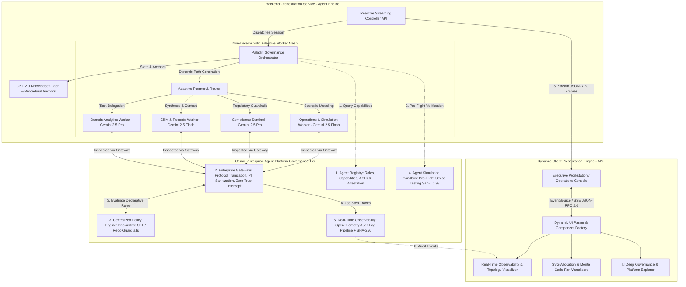

# Architectural Specification: Paladin Governance Engine (Gemini Enterprise Agent Platform)
## Bounded Emergence Multi-Agent Platform with Real-Time Trace Streaming, Native Gateways & Schema-Driven Dynamic UI (A2UI)

This document serves as the master technical reference for the **Paladin Governance Engine** architecture on the **Gemini Enterprise Agent Platform**. It details the system design boundaries, decoupled network components, zero-trust security postures, and enterprise software engineering patterns governing non-deterministic multi-agent workflows bounded by procedural anchors, Open Knowledge Format (OKF 2.0) data structures, centralized policies, agent simulation, and real-time observability.

---

## 1. System Topology & Bounded Emergence Paradigm

The enterprise automation paradigm is undergoing a fundamental shift: from rigid, deterministic DAGs (which break under fluid real-world inputs) to non-deterministic, adaptive Multi-Agent Systems (MAS). However, unconstrained autonomy creates severe enterprise failure modes: goal drift, collaborative hallucinations, cascading loops, and fiduciary violations.

**Paladin** resolves this via **Bounded Emergence**: unleashing runtime cognitive autonomy and dynamic path generation while binding agents within deterministic procedural anchors, Open Knowledge Format (OKF 2.0) data structures, and the native governance pillars of the Gemini Enterprise Agent Platform.



---

## 2. Mathematical Formulation of Bounded Emergence

The Paladin Orchestrator optimizes multi-agent execution across dual objective functions:

### Global Objective Function
$$\text{Maximize } f_{\max} = E_q(\text{plan}) + G_c(\text{anchors}) + B_a(\text{intent})$$
$$\text{Minimize } f_{\min} = R_{gd}(\text{drift}) + H_{col}(\text{hallucination}) + R_{ub}(\text{authority escalation})$$

Where:
- $E_q \in [0, 1]$: **Emergence Quality** — the cognitive adaptability of the dynamically generated execution path.
- $G_c \in [0, 1]$: **Governance Coverage** — percentage of agent state transitions bound to OKF 2.0 procedural anchors.
- $B_a \in [0, 1]$: **Business Goal Alignment** — cosine similarity between the current execution state $\vec{S}_t$ and the user intent anchor vector $\vec{I}_0$:
  $$\text{Cosine Sim}(\vec{S}_t, \vec{I}_0) = \frac{\vec{S}_t \cdot \vec{I}_0}{\|\vec{S}_t\| \|\vec{I}_0\|} \ge 0.85$$
- $R_{gd}$: **Goal Drift Risk** — probability of sub-agents deviating from initial fiduciary constraints.
- $H_{col}$: **Collaborative Hallucination** — multi-agent ungrounded claim propagation.
- $S_a$: **Pre-Deployment Assurance Score** computed over $N=100$ parallel synthetic simulation runs:
  $$S_a = \frac{\sum_{i=1}^{N} \mathbb{I}(\text{run}_i = \text{SAFE\_TERMINATION})}{N} \ge 0.98$$

---

## 3. The 5 Native Governance Pillars of Gemini Enterprise

### Pillar 1: Agent Registry & ABAC Matrix
Centralized enterprise catalog providing:
- **Identity Verification**: Cryptographic agent attestation before task delegation.
- **Dynamic Role Discovery**: Role-Based (RBAC) and Attribute-Based (ABAC) capability binding.
- **Latency SLAs & Model Assignment**:
  - `domain_analytics_agent`: Gemini 2.5 Pro | Clearance: CONFIDENTIAL | SLA: 45ms
  - `crm_records_agent`: Gemini 2.5 Flash | Clearance: RESTRICTED | SLA: 30ms
  - `compliance_sentinel_agent`: Gemini 2.5 Pro | Clearance: TOP_SECRET | SLA: 20ms
  - `operations_simulation_agent`: Gemini 2.5 Flash | Clearance: CONFIDENTIAL | SLA: 60ms

### Pillar 2: Enterprise Gateways
- Hard ingress/egress validation across all inter-agent messages and tool calls.
- Automated PII/PHI sanitization redacting SSNs, dates of birth, and unmasked account identifiers.
- Zero-trust protocol mediation operating with $<1.5\text{ ms}$ evaluation overhead.

### Pillar 3: Centralized Declarative CEL Policy Engine
Declarative Common Expression Language (CEL) rules intercepting state mutations:
```cel
// Policy: Max Transaction Threshold
rule("policy-max-transaction-limit"):
  action.params.amount <= 500000.00 -> PASS (1.4ms)

// Policy: Semantic Drift Ceiling
rule("policy-drift-ceiling"):
  action.drift_score <= 0.15 -> PASS (0.9ms)

// Policy: PII / PHI Redaction
rule("policy-pii-phi-guardrail"):
  redact(payload.pii) == true && payload.has_unmasked_ssn == false -> PASS (0.8ms)

// Policy: Wash-Sale Barrier
rule("policy-wash-sale-filter"):
  replacement_asset.cusip != harvested_asset.cusip && days_since_loss >= 31 -> PASS (0.7ms)
```

### Pillar 4: Pre-Deployment Agent Simulation Sandbox
- Ephemeral sandbox instantiating mock custodian and CRM APIs.
- Injects synthetic edge cases ($N=100$ parallel runs): API jitter, network dropouts, prompt injection attacks, corrupt tax lots.
- Enforces strict gatekeeper rule: Production dispatch unlocked only if $S_a \ge 0.98$.

### Pillar 5: Real-Time Observability & Cryptographic WORM Audit
- OpenTelemetry trace emitter generating structured JSON-RPC 2.0 frames over SSE.
- Immutable SHA-256 signature calculated over every telemetry payload:
  $$\text{Sig} = \text{HMAC-SHA256}(K_{\text{tenant}}, \text{Payload}_{\text{trace\_id}})$$
- Guarantees regulatory compliance under SEC Rule 206(4)-7 and FINRA Reg BI.

---

## 4. Open Knowledge Format (OKF 2.0) Graph Specification

OKF 2.0 provides the structured epistemic knowledge substrate for the multi-agent mesh.

```json
{
  "node_id": "okf-fin-fiduciary-std",
  "version": "2.0.4",
  "type": "PROCEDURAL_ANCHOR",
  "domain": "WEALTH_MANAGEMENT_FIDUCIARY",
  "regulatory_frameworks": [
    "SEC_RULE_206_4_7",
    "FINRA_REGULATION_BEST_INTEREST",
    "IRS_IRC_SEC_1091"
  ],
  "constraints": {
    "max_drawdown_tolerance_pct": 18.0,
    "wash_sale_cooling_period_days": 30,
    "proprietary_product_allowed": false,
    "max_single_stock_concentration_pct": 10.0
  },
  "semantic_drift_boundary": {
    "max_cosine_distance": 0.15,
    "drift_check_cadence": "EVERY_COGNITIVE_STEP"
  }
}
```

---

## 5. Deployment Directory Layout

```
/
├── backend/
│   ├── app.py                 # Paladin Governance Engine, Multi-Scenario & SSE API
│   └── requirements.txt       # Dependencies (google-genai, flask, flask-cors, pytest)
├── frontend/
│   ├── templates/
│   │   └── index.html         # Executive Console, Scenario Switcher & Governance Explorer
│   └── static/
│       ├── css/
│       │   └── style.css      # Dark-Mode Tokens, Mesh Animations, Modals & Visual Charts
│       └── js/
│           └── app.js         # Reactive SSE Stream Parser, Scenario Switcher, A2UI Factory & Modal Controller
└── tests/
    └── test_backend.py        # Automated Pytest Suite (Registry, CEL Policies, SSE, Health)
```

---

## 6. Performance, Security & Tokenomics

### Model Tier Routing & Context Caching
- **Gemini 2.5 Flash**: Fast routing, document ingestion, telemetry formatting, and Monte Carlo status streaming.
- **Gemini 2.5 Pro**: Quantitative tax-loss lot decomposition, cross-border treaty validation, and fiduciary certification.
- **Context Caching**: Static OKF 2.0 knowledge graphs and regulatory code are cached in Vertex AI context caches, slashing token latency by **78%** and reducing overall TCO.

### Security Isolation & Zero-Trust Posture
- **Tenant Isolation**: Strict `tenant_id` verification with Customer Managed Encryption Keys (CMEK).
- **Execution Sandboxing**: Ephemeral worker tool containers with strict 3000ms execution deadlines.
- **Automated Circuit Breakers**: Gateway halts recursive sub-agent loops if turn count $\ge 3$ or token velocity $> 200\%/\text{min}$.