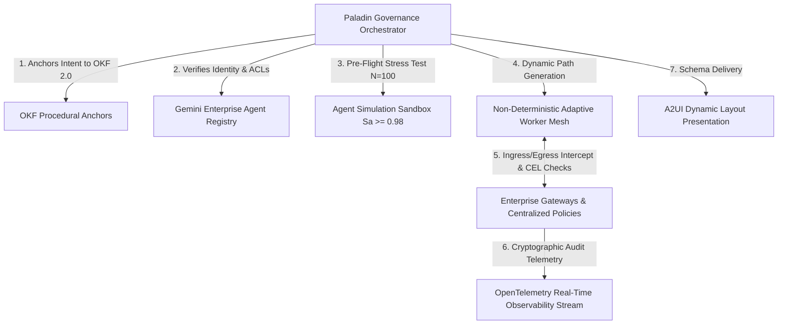

# Multi-Agent Development Guide: Best Practices for Bounded Emergence on Gemini Enterprise Agent Platform & A2UI

This guide serves as a definitive engineering playbook for developing resilient, high-performance, and non-deterministic multi-agent systems using the **Gemini Enterprise Agent Platform** (Agent Registry, Gateways, Centralized Policies, Agent Simulation, and Real-Time Observability) paired with **ADK (Agent Development Kit)** and **A2UI (Agent UI)**.

By applying the principles of **Emergence Engineering** governed by **Bounded Emergence**, engineering teams harness dynamic cognitive autonomy while enforcing absolute enterprise safety, determinism, and auditability.

---

## 1. Architectural Blueprint (Bounded Emergence Topology)

The industry paradigm has shifted from rigid, deterministic DAGs to adaptive Multi-Agent Systems (MAS). In this architecture, worker agents dynamically plan and execute solution paths at runtime, while the **Paladin Governance Engine** anchors their actions to deterministic business rules and Open Knowledge Format (OKF 2.0) knowledge graphs.



### Agent Registry Binding & Subagent Definition
To guarantee that only attested and certified sub-agents participate in non-deterministic workflows, sub-agents are declared and verified against the platform registry:

```python
# Subagent definition with strict routing isolation and registry binding
from google import genai
from google.genai import types

domain_analytics_agent = {
    "name": "domain_analytics_agent",
    "model": "gemini-2.5-pro",
    "clearance": "CONFIDENTIAL",
    "tools": ["CustodialPortfolioAccountingAPI", "TaxLotHarvestingEngine"],
    "system_instruction": "Decompose portfolio tax lots and identify wash-sale compliant loss harvest opportunities.",
    "latency_sla_ms": 45
}

compliance_sentinel_agent = {
    "name": "compliance_sentinel_agent",
    "model": "gemini-2.5-pro",
    "clearance": "TOP_SECRET",
    "tools": ["SecFiduciarySuitabilityChecker", "RegBiConflictDetector"],
    "system_instruction": "Evaluate fiduciary suitability under SEC Rule 206(4)-7 and eliminate proprietary product conflicts.",
    "latency_sla_ms": 20
}
```

---

## 2. Integration Failure Points & First-Round Corrections

When engineering backend services (e.g., Flask or FastAPI services on GCP Agent Engine) hosting ADK agents and Gemini Enterprise Gateways, address these critical framework patterns:

### Failure Point A: A2UI Site-Package Import Mismatches
* **The Issue**: The `a2ui-agent-sdk` relies on `a2a.types` exporting `DataPart` and `TextPart` models. Newer SDKs using Protobuf classes directly can trigger startup errors.
* **Best Practice**: Apply a lightweight, safe module monkeypatch at the very entry point of your application:
```python
import sys
import a2a.types
from a2a.compat.v0_3.types import DataPart, TextPart
a2a.types.DataPart = DataPart
a2a.types.TextPart = TextPart
sys.modules['a2a.types'] = a2a.types
```

### Failure Point B: ADK Session Initialization on Async Runners
* **The Issue**: Running agents via `InMemoryRunner.run_async(...)` will raise `SessionNotFoundError` if the session is not explicitly pre-created in the storage service.
* **Best Practice**: Enable auto-session creation on the runner instance and explicitly check/create sessions in the service:
```python
runner = InMemoryRunner(agent=paladin_governance_engine)
runner.auto_create_session = True

session = await runner.session_service.get_session(
    app_name=runner.app_name,
    user_id="executive_default",
    session_id=session_id
)
if not session:
    await runner.session_service.create_session(
        app_name=runner.app_name,
        user_id="executive_default",
        session_id=session_id
    )
```

### Failure Point C: ADK Callback Parameter Binding
* **The Issue**: The ADK engine invokes agent callbacks using keyword arguments (`callback(callback_context=ctx)`). Positional parameters trigger a `TypeError`.
* **Best Practice**: Declare callback signatures using the exact parameter name `callback_context`:
```python
def before_agent_callback(callback_context):
    logging.info(f"Agent Activated: {callback_context.agent_name} for Session {callback_context.session_id}")
    return None
```

---

## 3. Autonomous Failure Taxonomy Mitigation Protocols

To prevent the common pitfalls of non-deterministic Multi-Agent Systems, embed real-time dampeners into the orchestrator and gateway layers:

1. **Goal Drift ($\text{Cosine Sim} < 0.85$)**:
   - Compare the semantic vector of the agent's current state with the initial intent anchor.
   - If drift exceeds the threshold ($> 0.15$), force a step-back to the nearest OKF procedural anchor.
2. **Collaborative Hallucination**:
   - When agents pass ungrounded facts across memory layers, trigger a cross-agent grounding loop requiring empirical tool execution or authoritative database retrieval.
3. **Cascading Feedback Loops**:
   - If recursion depth reaches 3 or token consumption velocity spikes by $> 200\%/\text{min}$, trigger a Gateway circuit breaker to terminate the spinning branch and switch to a fallback solver.
4. **Unbounded Authority Escalation**:
   - Intercept tool calls proposing operations outside the agent's registered scope with immediate Centralized Policy denial (`POLICY_REJECT_SCOPE_VIOLATION`).

---

## 4. Pre-Deployment Assurance via Agent Simulation

High-consequence non-deterministic workflows must be validated prior to production deployment:

```python
async def run_preflight_simulation(agent_plan: Dict[str, Any], iterations: int = 100) -> float:
    """Spawns an isolated sandbox and executes parallel stress tests against synthetic edge cases."""
    successful_runs = 0
    for i in range(iterations):
        # Inject synthetic perturbations: API latency, malformed inputs, adversarial queries
        sim_result = await execute_sandbox_run(agent_plan, inject_faults=(i % 5 == 0))
        if sim_result.is_safe and sim_result.passed_policies:
            successful_runs += 1
    
    assurance_score = successful_runs / iterations
    if assurance_score < 0.98:
        raise AssuranceFailureException(f"Assurance Score {assurance_score:.2f} below required 0.98 threshold.")
    return assurance_score
```

---

## 5. High-Reasoning Consolidation (FCoT 3.0 Hillclimbing)

During synthesis, the orchestrator evaluates worker findings across three recursive apertures:
1. **Macro-Scale Analysis**: Macroeconomic conditions, enterprise regulatory regimes, and global policy constraints.
2. **Meso-Scale Analysis**: Sub-system allocation, cross-departmental data flows, and gateway policy ledgers.
3. **Micro-Scale Analysis**: Specific transactions, line-item calculations, cryptographic audit logs, and deterministic verification.
4. **Hillclimbing Pass**: Recursively evaluate recommendations against centralized CEL policies, resolve discrepancies, and commit immutable audit traces.

---

## 6. Premium Front-End Visual Architecture (A2UI)

The user interface must reflect the multi-agent cognitive mesh and live gateway activity in real time:

1. **Live Gateway Checkpoint Alerts**:
   - Highlight real-time Gateway intercepts, displaying rule evaluations, pass/reject status, and latency benchmarks (ms).
2. **Predictive Mesh Handoff Animations**:
   - Intercept agent delegation events (`onAgentDelegation`) to dynamically illuminate active nodes on the topology graph.
3. **Dynamic A2UI Component Factory**:
   - Render structured JSON widgets (`Tabs`, `PortfolioWithChart`, `MonteCarloVisual`, `RoiBreakdown`, `Roadmap`, `Certificate`) dynamically from backend SSE data streams without client rebuilds.
4. **Visual Asset Allocation & Monte Carlo Charts**:
   - Render dynamic SVG / CSS comparison tracks and fan charts reflecting stochastic regime resilience.

---

## 7. Zero-Dependency Automated Testing Strategy

Ensure all components are validated locally and in serverless CI/CD containers (Cloud Build):
* **Gateway & Policy Suite**: Test CEL rule evaluations against valid, excessive, and drifted payloads.
* **Registry Suite**: Ensure unregistered agents are blocked from execution.
* **Stream Suite**: Verify SSE HTTP 200 responses, `text/event-stream` headers, and valid JSON-RPC 2.0 schemas.


